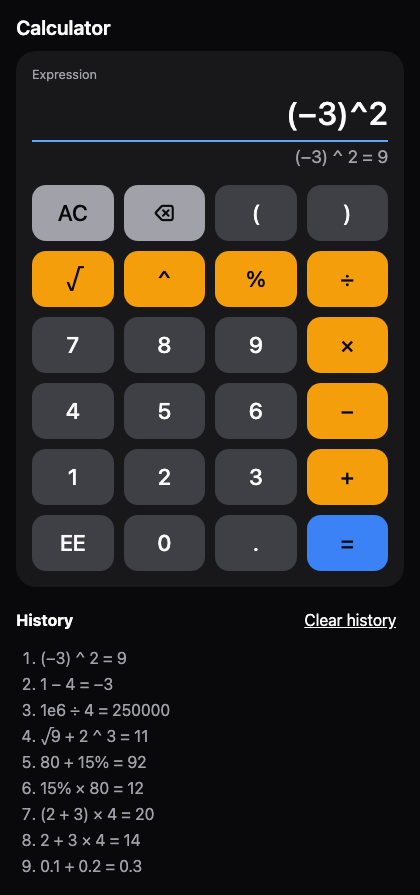
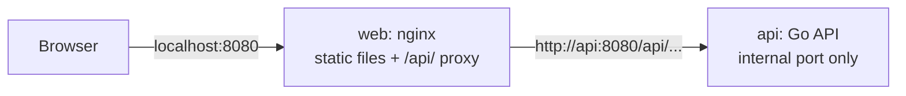

# Full-Stack Calculator

A web calculator that works like a phone calculator. A React and TypeScript frontend sends each expression to a Go REST API. The API parses the expression, calculates the result and returns JSON. Docker Compose runs the full app with 1 command.

The source of truth for behavior, the API contract and the tests is [SPEC.md](SPEC.md). The AI prompts that built the project are in [PROMPTS.md](PROMPTS.md).

## 1. Overview



- 7 operations: add, subtract, multiply, divide, power, square root and percentage.
- Expressions with more than 1 operator and with brackets, for example `(2 + 3) × 4 − 6 ÷ 3 = 18`.
- A phone-style keypad. You can also type on the keyboard: Enter calculates, Escape clears, and Backspace deletes 1 character.
- An operator after a result continues from the full result, not from the rounded display.
- The `%` key works like a phone calculator: `15% × 80 = 12` and `80 + 15% = 92`.
- Clear error messages for division by zero, the square root of a negative number, a result that is too large, a syntax error and an API that is not available.
- The last 10 calculations in a history list.
- A mobile-first layout that fits a 360px wide screen, with labels for screen readers.

## 2. Tech stack

| Part | Technology |
|---|---|
| Backend | Go 1.27 with the standard library `net/http` and `log/slog`. No web framework. |
| Frontend | React 19, TypeScript 6 (strict), Vite 8 and plain CSS. No UI component library. |
| Tests | Go `testing` and `httptest`, Vitest, React Testing Library, MSW, Playwright and `@axe-core/playwright`. |
| Lint | `go vet`, `golangci-lint`, ESLint (strict type-checked rules) and Prettier. |
| Runtime | Docker Compose with 2 services: `api` (distroless) and `web` (nginx-unprivileged). |
| CI | GitHub Actions. |

The browser talks only to nginx. nginx serves the frontend files and forwards `/api/` to the Go API on a private Compose network:



```text
Browser ──localhost:8080──▶ web (nginx) ──/api/──▶ api (Go, port 8080, not published)
```

The repository has these parts:

```text
backend/            Go module
  cmd/server/       entry point: configuration, graceful shutdown, `healthcheck` subcommand
  internal/calculator/  registry, parser and evaluator (no HTTP code)
  internal/api/     HTTP handlers, error mapping and middleware
frontend/           React app, Dockerfile and nginx configuration
  src/api/          typed fetch client
  src/errors/       error code to message map
  src/hooks/        calculator state hook and operations hook
  src/components/   Calculator, Display, Keypad, ErrorMessage and History
e2e/                Playwright tests against the Compose stack
compose.yaml        the 2 services
Makefile            the single entry point for all tasks
```

## 3. Prerequisites

| Tool | Version | Use |
|---|---|---|
| Docker Engine with Docker Compose | Compose v2 or later (tested with Docker 29.9.0 and Compose v5.5.0) | The full stack, and `make check`. |
| GNU Make | 3.81 or later | The Makefile targets. |
| Go | 1.27.2 | The backend in development mode and its tests. |
| golangci-lint | 2.14.0 | The backend lint. |
| Node.js and npm | Node 24.21.0 or later, npm 11 (tested with Node 24.21.0 and 26.11.1) | The frontend and the end-to-end tests. |

To run only the full app, you need only Docker.

## 4. Setup and run

1. Clone the repository:

   ```bash
   git clone <repository-url> calculator-api
   ```

2. Go to the repository folder:

   ```bash
   cd calculator-api
   ```

### Full stack with Docker Compose

Start the 2 services:

```bash
docker compose up --build
```

Open http://localhost:8080. The `web` service starts after the `api` service is healthy. `make up` does the same in the background, and waits until both services are healthy. `make down` stops the stack, and `make logs` shows the logs.

### Development mode

Run the backend and the frontend in 2 terminals. The frontend uses Vite hot reload.

1. Start the API on port 8080:

   ```bash
   make run-backend
   ```

2. Start the Vite dev server on http://localhost:5173:

   ```bash
   make run-frontend
   ```

The Vite dev server forwards `/api` to `http://localhost:8080`, so the dev setup uses the same paths as nginx. The `make` targets install the npm packages when necessary.

### Configuration

| Variable | Default | Use |
|---|---|---|
| `PORT` | `8080` | The HTTP port of the API. |
| `ALLOWED_ORIGINS` | `http://localhost:5173` | A comma-separated list of CORS origins. CORS is necessary only when the frontend and the API use different origins. The Compose stack does not need it. |
| `VITE_API_URL` | empty (same origin) | The API origin for the frontend build. |

## 5. Tests

There are 4 test levels. Each level tests through a public seam, as [SPEC.md](SPEC.md) describes.

| Level | Seam | Command | Tests |
|---|---|---|---|
| Backend HTTP API | Real HTTP requests to the full router with `httptest` | `make test-backend` | 13 tests with 55 table rows |
| Calculator module | The public `Evaluate` function and the registry list | `make test-backend` | 5 tests with 94 table rows |
| Server entry point | `run` with a real server and the `healthcheck` subcommand | `make test-backend` | 4 tests |
| Frontend | The full rendered app with MSW at the network boundary | `make test-frontend` | 69 tests |
| End-to-end | Playwright against the Compose stack, with no mocks | `make up`, then `make e2e` | 24 tests |

Other commands:

| Command | What it does |
|---|---|
| `make lint` | `go vet`, `golangci-lint`, ESLint, Prettier and the TypeScript type checks. |
| `make test` | The backend tests (with the race detector), the frontend tests, and a test that `make check` stops the stack when `make up` fails. |
| `make coverage` | The HTML and text coverage reports in `coverage/backend/` and `coverage/frontend/`. It fails if the backend coverage is below 90% or the frontend line coverage is below 85%. |
| `make e2e` | The Playwright tests. The stack must run (`make up`). The HTML report is in `e2e/playwright-report/`. |
| `make check` | Lint, tests, `make up`, `make e2e` and `make down`. It prints the Compose logs if the end-to-end tests fail. |

To take the README screenshot again, start the stack and run `npm run screenshot` in the `e2e` folder.

### Coverage summary

These are the real numbers from `make coverage`.

| Part | Statements | Branches | Functions | Lines | Target |
|---|---|---|---|---|---|
| Backend: calculator module | 99.5% | – | – | – | 90% of statements |
| Backend: API module | 97.4% | – | – | – | 90% of statements |
| Backend: calculator and API together | 98.7% | – | – | – | 90% of statements |
| Backend: server entry point | 76.0% | – | – | – | none |
| Frontend: all files | 97.4% | 94.48% | 100% | 100% | 85% of lines |

## 6. API reference

All requests go through nginx at `localhost:8080`. The responses below are real responses from the running stack.

### `POST /api/v1/calculate`

The request has 1 field, `expression`. The API also accepts the ASCII symbols `*`, `/` and `-`. The response contains the normalized expression and the raw `float64` result.

| Operation | Request | Response (HTTP 200) |
|---|---|---|
| add | `{"expression":"2+3"}` | `{"expression":"2 + 3","result":5}` |
| subtract | `{"expression":"10-4"}` | `{"expression":"10 − 4","result":6}` |
| multiply | `{"expression":"6*7"}` | `{"expression":"6 × 7","result":42}` |
| divide | `{"expression":"1/4"}` | `{"expression":"1 ÷ 4","result":0.25}` |
| power | `{"expression":"2^10"}` | `{"expression":"2 ^ 10","result":1024}` |
| sqrt | `{"expression":"√9"}` | `{"expression":"√9","result":3}` |
| percentage | `{"expression":"15%*80"}` | `{"expression":"15% × 80","result":12}` |
| phone percentage | `{"expression":"80+15%"}` | `{"expression":"80 + 15%","result":92}` |
| precedence | `{"expression":"2+3*4"}` | `{"expression":"2 + 3 × 4","result":14}` |
| brackets | `{"expression":"(2+3)*4"}` | `{"expression":"(2 + 3) × 4","result":20}` |
| raw `float64` | `{"expression":"0.1+0.2"}` | `{"expression":"0.1 + 0.2","result":0.30000000000000004}` |

Example:

```bash
curl localhost:8080/api/v1/calculate -H 'Content-Type: application/json' -d '{"expression":"2+3*4"}'
```

```json
{"expression":"2 + 3 × 4","result":14}
```

### Error codes

Each error response has a stable `code`. The `message` text can change. An `INVALID_EXPRESSION` error also has a `position`: the 0-based index of the character with the error.

| Code | HTTP | Request | Response |
|---|---|---|---|
| `INVALID_REQUEST` | 400 | `{"expression":5}` | `{"error":{"code":"INVALID_REQUEST","message":"the request body is not a valid calculate request"}}` |
| `INVALID_REQUEST` | 400 | `-H 'Content-Type: text/plain'` | `{"error":{"code":"INVALID_REQUEST","message":"the Content-Type must be application/json"}}` |
| `REQUEST_TOO_LARGE` | 413 | A body larger than 1 MB | `{"error":{"code":"REQUEST_TOO_LARGE","message":"the request body is larger than 1 MB"}}` |
| `INVALID_EXPRESSION` | 400 | `{"expression":"2*(1+2"}` | `{"error":{"code":"INVALID_EXPRESSION","message":"a closing bracket is missing","position":2}}` |
| `DIVISION_BY_ZERO` | 422 | `{"expression":"1/0"}` | `{"error":{"code":"DIVISION_BY_ZERO","message":"cannot divide by zero"}}` |
| `INVALID_DOMAIN` | 422 | `{"expression":"√-1"}` | `{"error":{"code":"INVALID_DOMAIN","message":"input is outside the domain of the operation"}}` |
| `RESULT_OUT_OF_RANGE` | 422 | `{"expression":"1e308*10"}` | `{"error":{"code":"RESULT_OUT_OF_RANGE","message":"result is out of range"}}` |
| `NOT_FOUND` | 404 | `curl localhost:8080/api/v1/unknown` | `{"error":{"code":"NOT_FOUND","message":"the path does not exist"}}` |
| `METHOD_NOT_ALLOWED` | 405 | `curl -X GET localhost:8080/api/v1/calculate` | `{"error":{"code":"METHOD_NOT_ALLOWED","message":"the method is not allowed"}}` |
| `INTERNAL_ERROR` | 500 | Only after an unexpected panic. A request cannot cause it. The tests cause it with a fake evaluator. | `{"error":{"code":"INTERNAL_ERROR","message":"an internal error occurred"}}` |

Example:

```bash
curl localhost:8080/api/v1/calculate -H 'Content-Type: application/json' -d '{"expression":"1/0"}'
```

```json
{"error":{"code":"DIVISION_BY_ZERO","message":"cannot divide by zero"}}
```

### `GET /api/v1/operations`

```bash
curl localhost:8080/api/v1/operations
```

```json
{"operations":[{"name":"add","symbol":"+","notation":"infix","arity":2},{"name":"subtract","symbol":"−","notation":"infix","arity":2},{"name":"multiply","symbol":"×","notation":"infix","arity":2},{"name":"divide","symbol":"÷","notation":"infix","arity":2},{"name":"power","symbol":"^","notation":"infix","arity":2},{"name":"sqrt","symbol":"√","notation":"prefix","arity":1},{"name":"percentage","symbol":"%","notation":"postfix","arity":1}]}
```

### `GET /healthz`

The health endpoint is for Docker. The `api` port is not published, so call it from inside the Compose network:

```bash
docker compose exec web wget -qO- http://api:8080/healthz
```

```json
{"status":"ok"}
```

### Expression rules

| Rule | Example |
|---|---|
| `×` and `÷` come before `+` and `−`. | `2 + 3 × 4 = 14` |
| `^` comes before unary minus and `√`, and is right-associative. | `−2 ^ 2 = −4`, `2 ^ 3 ^ 2 = 512` |
| `x%` is `x ÷ 100`. | `50% = 0.5`, `15% × 80 = 12` |
| After `+` or `−`, a `%` term is a percentage of the left value, also with a unary minus. Brackets stop the rule. | `80 + 15% = 92`, `80 − 15% = 68`, `80 + −15% = 68`, `80 + (−15%) = 79.85` |
| Numbers can be negative, decimal or in exponent notation. | `−1.5`, `.5`, `1e6`, `2.5e-3` |
| Implicit multiplication is not allowed. | `2(3)` gives `INVALID_EXPRESSION` |
| An expression has 200 characters at most, and a bracket depth of 32 at most. | |

## 7. Design decisions and assumptions

These reasons come from the "Further Notes" section of [SPEC.md](SPEC.md).

- **1 expression endpoint with a registry.** There are 3 alternatives: 1 endpoint per operation, 1 endpoint for 1 operation with its operands, or 2 endpoints. The keypad sends a full expression, so an expression endpoint is necessary. A second endpoint for 1 operation adds code and tests, but the frontend does not use it, and an expression such as `2 + 3` does the same job. So there is 1 endpoint, with 1 validation path and 1 error format. The registry holds the symbol, the precedence and the function of each operation, and the parser reads them from the registry. A new operation is 1 registry entry and does not need a new route. The cost: an API client sends a string, not structured operands.
- **The backend does all calculations.** The assignment says that the frontend consumes the API. If both parts calculate, they can disagree. So the parser and the calculation are in the backend only. The frontend only filters characters and checks for an empty expression.
- **Percentage definition (assumption).** The assignment does not define "percentage". This project uses the rule of a phone calculator: `x%` is `x ÷ 100`, and `a + b%` is `a + b% of a`. So "15% of 80" is `15% × 80 = 12`, and a 15% increase of 80 is `80 + 15% = 92`.
- **Order of operations.** The calculator uses the standard mathematical order, as a modern phone calculator does: `2 + 3 × 4 = 14`, not 20. `−2 ^ 2 = −4`, because `^` binds more tightly than unary minus.
- **Floating-point precision.** All numbers are IEEE 754 `float64` values. The API returns the raw result, so an API client gets the true value: `0.1 + 0.2` returns `0.30000000000000004`. The UI rounds to 12 significant digits only for display, so it shows `0.3`. When you continue from a result, the UI sends the full value: `1 ÷ 3 = 0.333333333333`, then `× 3`, gives `1`.
- **Status 422 compared to 400.** 400 means that the request is malformed, and this includes a syntax error in the expression. 422 means that the expression is valid, but there is no mathematical result. An API client can tell its own errors from domain errors.
- **Expression limits.** The limits of 200 characters and a bracket depth of 32 stop very long or very deep input. Deep input can use too much stack in a recursive parser.
- **Keypad with a text input.** A text input with `inputmode="none"` gives a visible label, screen reader support, normal keyboard typing and Enter, and it does not open the phone keyboard. The keypad buttons add the touch layout of a phone calculator.
- **2 services with Docker Compose.** Each service has 1 job. nginx is good at static files, caching, compression and security headers. The Go service does only the API. The 2 parts build, scale and update independently. nginx forwards `/api/` to the API, so the browser sees 1 origin and the stack needs no CORS. The cost is 1 more image and an nginx configuration file to maintain. A single Go binary that embeds the frontend is simpler, but it mixes 2 jobs in 1 service.

Other implementation notes:

- nginx checks the body size before the API does. For `/api/`, nginx returns the same `REQUEST_TOO_LARGE` JSON error as the API, so the contract does not change behind the proxy.
- nginx resolves the `api` name through the Docker DNS on each request, so a restart of the `api` container does not break the proxy.
- All dependencies have exact versions. The base images have an exact tag and a digest, and the GitHub Actions have a commit SHA.

## 8. Possible future work

- An `Ans` key and memory keys (M+, M−, MR).
- More functions, for example `π`, logarithms and trigonometry, as new registry entries.
- Cursor editing inside the expression, and a highlight on the character of a syntax error.
- Decimal arithmetic for money calculations, so that `0.1 + 0.2` is exactly `0.3`.
- A history that stays after a page reload.
- Rate limiting, metrics and tracing for a public deployment.
- TLS in front of the `web` service, and a deployment to a cloud provider.
- Multi-architecture images and an image vulnerability scan in CI.
